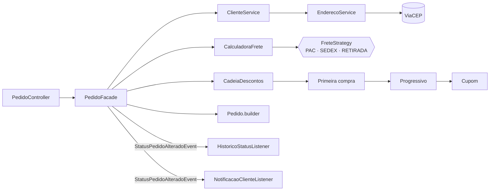

# Padrões de Projeto com Spring — Desafio DIO

API REST de **pedidos com cálculo de frete e descontos**, feita com Spring Boot para praticar os padrões de projeto do GoF.
Inspirada no projeto de referência [digitalinnovationone/lab-padroes-projeto-spring](https://github.com/digitalinnovationone/lab-padroes-projeto-spring), mas criada do zero com outro domínio e mais padrões.

O cliente se cadastra só com o CEP (o endereço vem do [ViaCEP](https://viacep.com.br)), simula o frete para a sua região e faz pedidos. Cada pedido passa por uma cadeia de descontos e segue um fluxo de status com histórico e notificação.

## Padrões aplicados

| Padrão | Onde | O que resolve |
|---|---|---|
| **Singleton** | Todos os `@Service`, `@Component` e `@Configuration` | O Spring cria uma única instância de cada bean e a injeta onde for preciso. |
| **Strategy** | [`frete/`](src/main/java/br/com/dio/padroes/frete) — `FreteStrategy`, `FretePac`, `FreteSedex`, `FreteRetirada` | Cada modalidade tem seu algoritmo de cálculo. A `CalculadoraFrete` recebe todas pelo Spring e escolhe pela modalidade, sem `switch`. Nova modalidade = nova classe `@Component`. |
| **Chain of Responsibility** | [`desconto/`](src/main/java/br/com/dio/padroes/desconto) — `RegraDesconto` e suas regras | Primeira compra → compra acima de R$ 500 → cupom. Cada regra concede (ou não) seu desconto e passa adiante. A ordem vem do `@Order`. Cupom inválido interrompe a corrente. |
| **Facade** | [`PedidoFacade`](src/main/java/br/com/dio/padroes/service/PedidoFacade.java) | Um ponto de entrada que orquestra cliente, frete, descontos, montagem do pedido e eventos. O controller só chama `criar` ou `alterarStatus`. |
| **Builder** | [`Pedido.builder()`](src/main/java/br/com/dio/padroes/model/Pedido.java) | Monta o pedido passo a passo e só entrega um objeto consistente, com total calculado e status inicial. |
| **State** | [`StatusPedido`](src/main/java/br/com/dio/padroes/model/StatusPedido.java) | Cada status sabe para quais pode ir. A regra de transição mora no próprio estado. |
| **Observer** | [`evento/`](src/main/java/br/com/dio/padroes/evento) — `ApplicationEventPublisher` + listeners | A mudança de status publica um evento. Um listener grava o histórico (na mesma transação) e outro "envia o e-mail" só depois do commit (`@TransactionalEventListener`). |
| **Proxy** | [`ViaCepClient`](src/main/java/br/com/dio/padroes/integracao/ViaCepClient.java) | Interface HTTP do Spring: o framework gera a implementação que faz a chamada ao ViaCEP. |
| **Adapter** | [`EnderecoService`](src/main/java/br/com/dio/padroes/service/EnderecoService.java) | Converte a resposta do ViaCEP para a entidade `Endereco` e guarda no banco, para não consultar o mesmo CEP duas vezes. |



## Regras de negócio

**Frete** — o centro de distribuição fica em SP; o custo e o prazo crescem com a distância da região de destino.

| Modalidade | Valor | Prazo |
|---|---|---|
| PAC | (R$ 10 + R$ 2,50/kg) × fator da região | 5 dias + 2 por região de distância |
| SEDEX | (R$ 18 + R$ 4,00/kg) × fator da região | 1 dia + 1 por região de distância |
| RETIRADA | Grátis | 1 dia |

Fatores: Sudeste 1.0 · Sul 1.2 · Centro-Oeste 1.4 · Nordeste 1.6 · Norte 1.9.

**Descontos** (se acumulam, limitados ao valor do pedido)
- Primeira compra do cliente: 10% sobre os produtos
- Produtos a partir de R$ 500: 5%
- Cupom `DIO10`: 10% sobre os produtos
- Cupom `FRETEGRATIS`: zera o frete

**Status** — `CRIADO → PAGO → ENVIADO → ENTREGUE`. Dá para cancelar em `CRIADO` ou `PAGO`; depois de enviado, não.

## Endpoints

| Método | Rota | Descrição |
|---|---|---|
| GET | `/clientes` | Lista clientes |
| GET | `/clientes/{id}` | Busca um cliente |
| POST | `/clientes` | Cadastra (`nome`, `email`, `cep`) |
| PUT | `/clientes/{id}` | Atualiza |
| DELETE | `/clientes/{id}` | Remove |
| GET | `/clientes/{id}/frete?pesoKg=2` | Compara todas as modalidades de frete |
| GET | `/pedidos?clienteId=1` | Lista pedidos (filtro opcional) |
| GET | `/pedidos/{id}` | Busca um pedido |
| POST | `/pedidos` | Cria (`clienteId`, `valorProdutos`, `pesoKg`, `modalidadeFrete`, `cupom`) |
| PATCH | `/pedidos/{id}/status` | Muda o status (`{"status": "PAGO"}`) |
| GET | `/pedidos/{id}/historico` | Histórico de status |

Erros seguem o formato Problem Details (RFC 9457): 404 para recurso/CEP inexistente, 422 para regra de negócio (cupom inválido, transição de status proibida), 502 se o ViaCEP estiver fora.

### Exemplo

```http
POST /pedidos
{ "clienteId": 1, "valorProdutos": 550, "pesoKg": 2, "modalidadeFrete": "PAC", "cupom": "FRETEGRATIS" }
```

Para um cliente em Brasília (Centro-Oeste), primeira compra:

```json
{
  "valorProdutos": 550,
  "valorFrete": 21.00,
  "prazoEntregaDias": 9,
  "descontos": [
    { "descricao": "Primeira compra (10%)", "valor": 55.00 },
    { "descricao": "Compra acima de R$ 500 (5%)", "valor": 27.50 },
    { "descricao": "Cupom FRETEGRATIS", "valor": 21.00 }
  ],
  "valorDesconto": 103.50,
  "valorTotal": 467.50,
  "status": "CRIADO"
}
```

## Como rodar

Requisito: Java 21 ou superior (o Maven vem pelo wrapper).

```bash
./mvnw spring-boot:run        # Windows: mvnw.cmd spring-boot:run
```

- Swagger UI: http://localhost:8080/swagger-ui.html
- Console do H2: http://localhost:8080/h2-console (JDBC URL `jdbc:h2:mem:pedidos`, usuário `sa`)

## Testes

```bash
./mvnw test
```

Testes unitários para o Strategy de frete, a cadeia de descontos e as transições de status, e um teste de integração da API com o ViaCEP mockado, cobrindo o fluxo completo do pedido.

## Tecnologias

Java 21 · Spring Boot 3.5 · Spring Web · Spring Data JPA · Bean Validation · H2 · springdoc-openapi · JUnit 5 · Mockito
